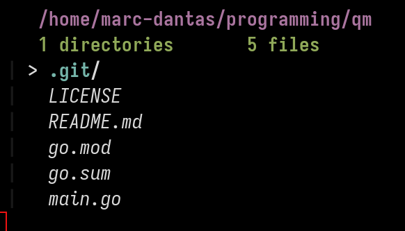

# qm
quick manager



## Getting started
qm is a simple terminal file manager written in Go.

### Building from source-code
Clone this repository and build qm from source-code using the [Go compiler](https://go.dev/doc/install).
```console
$ cd path/to/qm
$ go build
```

## Usage
Basic usage of qm:

### Navigation
- `W` select item above cursor
- `S` select item below cursor
- `A` go to parent directory
- `D` go inside selected directory
- `Q` exit qm

### File Management
- `R` rename the selected item
- `X` delete the selected item permanently
- `M` press to set the selected file to _move mode_.
      Then, navigate to where you want to move the file and press `M` again
- `[SPACE]` execute command with selected file
